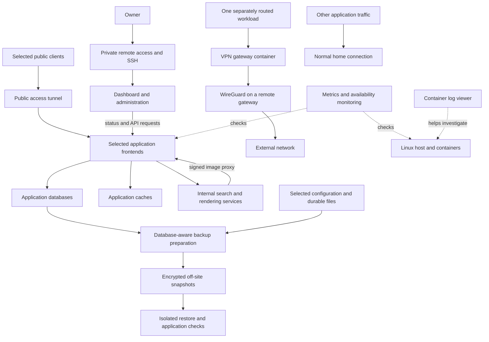

# How the system fits together

A simplified map of the repository configuration and dated deployment records.
Labels are generic; connections describe responsibilities, not a live network inventory.

## Application connections

Compose defines how an application starts, where its persistent state lives and
which services it depends on. A representative application waits for PostgreSQL
to become healthy; its database remains on the stack's own network while its
frontend also joins a shared network for integrations.

The metadata application uses Redis for caching, an internal search service and
a separate image renderer. Clients receive proxied image URLs rather than needing
the renderer's internal container name. The dashboard calls application APIs;
these integrations can fail even when each container is healthy.

The photo application has its own PostgreSQL, cache and machine-learning worker.
Monitoring combines host/container metrics, visual dashboards and availability
checks. A log viewer supports investigation. These are distinct signals: a healthy
container does not prove an authenticated API or end-user action works.

## Network boundaries and tradeoffs

The public tunnel and private administration path serve different purposes.
Selected applications also publish host ports; the tunnel is not the only possible
entry path. A shared network simplifies cross-stack integrations but is not strong
isolation between every service. Docker-socket access for administration is
privileged. These choices and their limits are explained in
[networking-security.md](networking-security.md).

One workload shares a VPN container's network namespace. Its traffic goes through
a remote WireGuard gateway while other applications keep their normal route.
Recreating the gateway can require recreating its dependent workload too.

## Recovery connections

Database dumps, SQLite copies and selected filesystem state feed the backup set.
Some application settings live outside the database and must be captured together.
Image versions, numeric file ownership and startup order affect whether restored
state works. [Backup strategy](backup-strategy.md) explains these dependencies.

This diagram omits addresses, private names, accounts and service inventories.
It summarizes inspected files; current production connectivity was not rechecked.
